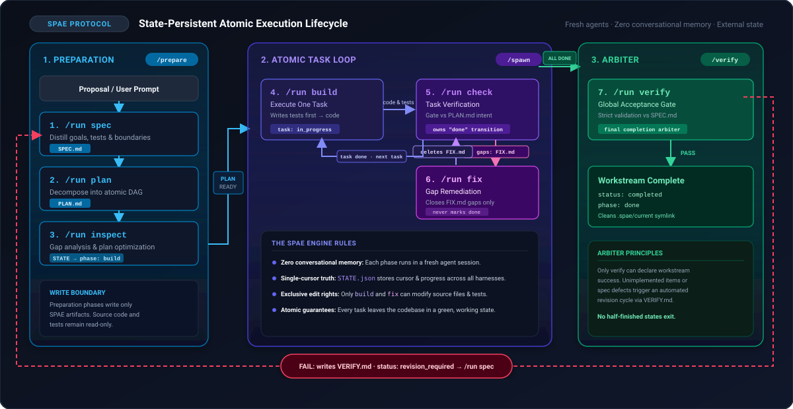
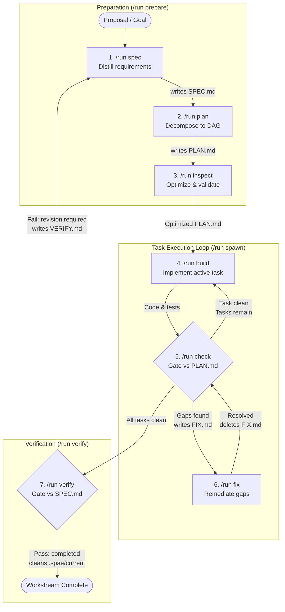

# State-persistent atomic execution framework

The `SPAE` framework provides a cross-platform, agent-first, structured
workflow loop for AI agent harnesses.

It runs a seven-step loop that produces consistent, high-quality,
predictable `LLM` outputs, even when using lower-tier agents. Gaps found
at the end feed back to the start. The loop exits only when `verify`
passes.

**spec → plan → inspect → build → check → fix → verify**



> **Official harness**: `Pi` serves as the official and recommended
> harness for `SPAE`. Orchestration testing covered `Pi` and `Agy`.
> Other harnesses run each phase by hand, with orchestration untested.
> See [Installation](#installation).

## What `SPAE` does

`SPAE` prevents context drift, hallucination, and scope creep by:

- Decomposing requests into atomic, independently verifiable tasks
- Persisting state in external artifacts (not conversational memory)
- Enforcing phase boundaries so each agent reads only what it needs
- Allowing any harness (`Pi`, `Claude`, `Agy`, `Gemini`, `OpenCode`,
  `Codex`, etc.) to resume work at any point

## Contents

- [Framework design](#framework-design)
- [Usage](#usage)
- [Workflow](#workflow)
- [Orchestration](#orchestration-pi-and-agy)
- [Post-verification](#post-verification)
- [Utility agents](#utility-agents)
- [Artifacts](#artifacts)
- [Prerequisites](#prerequisites)
- [Installation](#installation)
- [Smoke test](#smoke-test)

---

## Framework design

- **Harness agnostic**—use any combination of `Pi`, `Claude`, `Agy`,
  `Gemini`, `OpenCode`, `Codex`, etc., at each phase, though `Pi`
  remains recommended
- **Fresh agent per phase**—each phase starts a new agent with no shared
  conversation. Mix providers and models per phase, for example a
  stronger model for `inspect`, `check`, and `verify` (see
  [Agents](#agents))
- **Human oversight**—run each phase by hand, or automate with
  orchestration agents (`Pi`, `Agy`)
- **Fault-tolerant resumption**—`SPAE` saves progress after every phase,
  so a dropped connection, agent error, or halted orchestration loses no
  finished work. Resume from any harness:
  - Rerun the interrupted phase, or
  - Run `/run orchestrate` to continue autonomously
- **Atomic execution**—every task stays small enough to verify in a
  single cycle
- **Independent verification**—the agent that writes code never approves
  it. Separate agents check each task against the plan and the finished
  work against the spec
- **Closed loop**—`verify` feeds gaps back to `spec`, and the workflow
  ends only when `verify` passes

See [`docs/spae-framework.md`](docs/spae-framework.md) for the complete
protocol specification, execution guardrails, and lifecycle details.

---

## Usage

Invoke any agent with `/run <agent> [argument]` (or `$run` in `Codex`).
Agents encapsulate skills and carry out each phase. See each agent's
invocation for its arguments.

| Agent     | Invocation             |
| --------- | ---------------------- |
| `spec`    | `/run spec <proposal>` |
| `plan`    | `/run plan`            |
| `inspect` | `/run inspect`         |
| `build`   | `/run build`           |
| `check`   | `/run check`           |
| `fix`     | `/run fix`             |
| `verify`  | `/run verify`          |

`OpenCode` reserves `plan` and `build`, so its agents use `decompose`
and `implement` instead. See [`opencode/README.md`](opencode/README.md).

---

## Workflow

Run phases in order, looping until `/run verify` passes. Each agent
reads only its designated inputs and writes only its designated outputs.
Each `/run` call spawns a fresh agent, so `build`, `check`, and `fix` on
one task each run in separate agents. Invoking skills directly in one
session forfeits this isolation.

The workflow nests two loops:

- **Task loop**—`build → check ⇄ fix` repeats per task until `check`
  marks it `done`
- **Workstream loop**—`verify → spec` repeats until `verify` passes



| Phase | Agent                  | Purpose                                |
| ----- | ---------------------- | -------------------------------------- |
| 1     | `/run spec <proposal>` | Distill requirements to `SPEC.md`      |
| 2     | `/run plan`            | Decompose `SPEC.md` to atomic tasks    |
| 3     | `/run inspect`         | Optimize `PLAN.md` via gap analysis    |
| 4     | `/run build`           | Execute one atomic task from `PLAN.md` |
| 5     | `/run check`           | Gate completed task against `PLAN.md`  |
| 6     | `/run fix`             | Close gaps found by `/run check`       |
| 7     | `/run verify`          | Verify code against `SPEC.md`          |

The task loop alternates between build, check, and Remediation Fix (FIX)
cycles:

- `/run build`—executes the active atomic task and sets phase to `check`
- `/run check`—verifies active task implementation against `PLAN.md`.
  Marks task `done` if clean, or writes `FIX.md` and routes to
  `/run fix` if gaps exist
- `/run fix`—closes gaps listed in `FIX.md`, deletes `FIX.md`, and
  returns phase to `check`

If `/run verify` finds gaps, it creates `VERIFY.md` and resets state to
`/run spec`, restarting the workstream loop. Repeat until `/run verify`
passes.

---

## Orchestration (`Pi` and `Agy`)

> **Testing covered `Pi` and `Agy` only.** Orchestration requires nested
> subagent support. `Pi` users must install
> [`mystilleef/pi-subagent`](https://github.com/mystilleef/pi-subagent).
> `Agy` ships native nested subagents.

Orchestration agents spawn and drive nested `subagents` autonomously,
completing multi-agent workflows without human intervention at each
step.

---

### **`SPAE`** orchestrators

| Agent         | Invocation                      | Purpose                   |
| ------------- | ------------------------------- | ------------------------- |
| `orchestrate` | `/run orchestrate [<proposal>]` | Run all phases            |
| `prepare`     | `/run prepare [<proposal>]`     | Run prep phases (1-3)     |
| `spawn`       | `/run spawn`                    | Cycle all remaining tasks |

**`orchestrate`** reads `STATE.json`, determines the current phase, and
spawns the appropriate `SPAE` agent sequentially until the workflow
completes or the agent surfaces a blocker. Pass a proposal on first run
to seed the `spec` phase.

**Resume**—after any agent halts the workflow, for any reason, run
`/run orchestrate` without a proposal. `orchestrate` reads `STATE.json`
and picks up where the last agent left off.

**`prepare`** runs the preparatory phases—spec, plan, and
inspect—autonomously until the workflow reaches the `build` phase. Pass
a proposal on first run to seed the `spec` phase.

**`spawn`** targets the build phase exclusively—iterates all remaining
tasks, cycling `build`, `check`, and `fix` per task until the phase
advances to `verify`.

---

### Non-**`SPAE`** orchestrators

| Agent      | Invocation      | Purpose                              |
| ---------- | --------------- | ------------------------------------ |
| `coverage` | `/run coverage` | Spawn test agents for gaps           |
| `clean`    | `/run clean`    | Run purify and refactor sequentially |

The `coverage` and `clean` agents execute phases of their subagents
repeatedly until they achieve the desired outcome.

---

## Post-verification

After `/run verify` passes, run these agents to refine and ship the
implementation. Follow the order below.

| Order | Agent           | Purpose                          |
| ----- | --------------- | -------------------------------- |
| 1     | `/run test`     | Fill test coverage gaps          |
| 2     | `/run purify`   | Simplify and optimize code       |
| 3     | `/run refactor` | Improve structure and clarity    |
| 4     | `/run review`   | Review for correctness and style |
| 5     | `/run commit`   | Stage and commit implementation  |

**Tested on `Pi` and `Agy` only.** `/run coverage` and `/run clean`
operate as orchestration agents. `/run clean` replaces steps 2–3 by
running `purify` then `refactor` automatically.

---

## Utility agents

These agents run independently of the `SPAE` workflow. Use them at any
point to avoid polluting the main conversation context.

| Agent               | Purpose                                           |
| ------------------- | ------------------------------------------------- |
| `/run work`         | Run ad-hoc tasks in an isolated session           |
| `/run query`        | Answer questions or research without side effects |
| `/run troubleshoot` | Diagnose and fix issues                           |

---

## Artifacts

All artifacts live in `.spae/<workstream>/`. Never commit this
directory—add `.spae/` to `.gitignore`.

| File         | Purpose                                            |
| ------------ | -------------------------------------------------- |
| `STATE.json` | Execution cursor—tracks phase and active task      |
| `SPEC.md`    | Normalized requirements—immutable during execution |
| `PLAN.md`    | Atomic task graph—immutable during execution       |
| `VERIFY.md`  | Ephemeral signal—created when verification fails   |
| `FIX.md`     | Ephemeral signal—created when task check fails     |

---

## Prerequisites

- Harness must support the
  [Agent Skills specification](https://agentskills.io/home)
- Subagent support recommended for all harnesses
- Nested subagent support required for orchestration
- Custom commands, skills, or prompts recommended
- `Pi` (official, recommended) requires
  [mystilleef/pi-subagent](https://github.com/mystilleef/pi-subagent)

---

## Installation

### Using the installer

From a local clone:

```sh
./install.sh <harness>...     # pi claude agy opencode codex gemini, or all
./install.sh -u <harness>...  # uninstall
```

- Destinations match the manual tables below.
- `antigravity` aliases `agy`.
- `all` installs every harness found in `PATH` except deprecated
  `gemini`. Uninstall `all` covers all six harnesses.
- On `Windows`, the script runs only under `WSL`.
- Pre-flight validates the whole selection before any write.
- Edited, linked, and foreign files survive. `--force` backs up edited
  files first.

| Option              | Effect                                       |
| ------------------- | -------------------------------------------- |
| `-n`, `--dry-run`   | Report planned actions without writing       |
| `-f`, `--force`     | Back up, then replace or remove edited files |
| `-u`, `--uninstall` | Remove shipped files                         |
| `-v`, `--verbose`   | Also report unchanged files                  |
| `-h`, `--help`      | Show usage                                   |

| Exit | Meaning                        |
| ---- | ------------------------------ |
| `0`  | Success                        |
| `1`  | Pre-flight or runtime failure  |
| `2`  | Usage error                    |
| `3`  | Completed, skipped ≥1 conflict |

Each file gets one status line:

| Symbol | Meaning                                                 |
| ------ | ------------------------------------------------------- |
| `+`    | Installed                                               |
| `~`    | Backed up and replaced (`--force`)                      |
| `=`    | Unchanged (`--verbose`)                                 |
| `!`    | Conflict skipped: edited file, symlink, or obstruction  |
| `-`    | Removed, `--force` backs up edited files first          |
| `?`    | _Unshipped_ file inside a shipped skill directory, kept |

#### Overrides

| Variable              | Replaces                   |
| --------------------- | -------------------------- |
| `CLAUDE_CONFIG_DIR`   | `~/.claude`                |
| `PI_CODING_AGENT_DIR` | `~/.pi/agent`              |
| `XDG_CONFIG_HOME`     | `~/.config` (`OpenCode`)   |
| `CODEX_HOME`          | `~/.codex`                 |
| `XDG_STATE_HOME`      | `~/.local/state` (backups) |

- Empty values fall back to defaults. Relative values cause pre-flight
  errors.
- Backups land in `<state>/spae/backups/<UTC stamp>/<absolute path>`.

#### Notes

- `~/.agents/skills/` serves `pi`, `opencode`, `codex`, and `gemini`.
  Uninstall operations keep it until the selection covers all four
  harnesses.
- `Pi` requires [pi-subagent](https://github.com/mystilleef/pi-subagent)
  for `/run`, though the installer only prints a reminder.
- Restart running harness sessions after install or uninstall.
- `OpenCode` reads both `~/.claude/skills/` and `~/.agents/skills/`.
  Installing `claude` and `opencode` together places each skill in both.
  Delete one copy if `OpenCode` lists duplicates.
- Renamed or deleted upstream skills, agents, and commands leave old
  copies behind. The installer never reports or removes them, so delete
  them manually.

### Manual installation

Manual steps below serve as fallback.

Use `Pi` (bold in the tables below) for the full workflow, including
orchestration. Its agents and install steps live in
[`pi/README.md`](pi/README.md).

#### Skills

Copy the contents of `skills/` to each harness's skills directory.
Skills carry out each phase and work with any compliant harness.

| Harness    | Destination                |
| ---------- | -------------------------- |
| **`Pi`**   | `~/.agents/skills/`        |
| `Claude`   | `~/.claude/skills/`        |
| `Agy`      | `~/.gemini/config/skills/` |
| `Gemini`   | `~/.agents/skills/`        |
| `OpenCode` | `~/.agents/skills/`        |
| `Codex`    | `~/.agents/skills/`        |

#### Agents

Agents wrap skills in isolated sessions. Each harness requires its own
agent files. Every harness ships the same agents.

Shipped agent files inherit model and provider from the parent agent,
keeping front matter minimal. To mix models, add `model` or `provider`
fields to your copies on harnesses that support them.

| Harness    | Source                | Destination                  |
| ---------- | --------------------- | ---------------------------- |
| **`Pi`**   | `pi/agents/`          | `~/.pi/agent/agents/`        |
| `Claude`   | `claude/agents/`      | `~/.claude/agents/`          |
| `Agy`      | `antigravity/agents/` | `~/.gemini/config/agents/`   |
| `Gemini`   | `gemini/agents/`      | `~/.gemini/agents/`          |
| `OpenCode` | `opencode/agents/`    | `~/.config/opencode/agents/` |
| `Codex`    | `codex/agents/`       | `~/.codex/agents/`           |

> `Google` deprecated `Gemini CLI` in favor of `Agy`, the Antigravity
> CLI. Use the `antigravity/` files for new installs. The `gemini/`
> files receive no further updates.

#### Run command

The `/run` command orchestrates subagent invocation. Invoke agents as
`/run <agent> [argument]`. Format varies by harness.

| Harness    | Notes                                                                 |
| ---------- | --------------------------------------------------------------------- |
| **`Pi`**   | Requires `mystilleef/pi-subagent` for built-in `/run`                 |
| `Claude`   | Copy `claude/commands/` to `~/.claude/commands/`                      |
| `Agy`      | Copy `antigravity/skills/` to `~/.gemini/config/skills/`              |
| `Gemini`   | Copy `gemini/commands/` to `~/.gemini/commands/`                      |
| `OpenCode` | Copy `opencode/commands/` to `~/.config/opencode/commands/`           |
| `Codex`    | Copy `codex/skills/` to `~/.codex/skills/`, and use `$run` for `/run` |

---

## Smoke test

Verify harness setup with
[`examples/proposal.md`](examples/proposal.md), a tiny `slug` `CLI`
project.

1. Copy `examples/proposal.md` to an empty directory outside this
   repository.
2. Start the harness there.
3. Seed the workflow:
   - Manual: `/run spec proposal.md`, then each phase in order
   - **`Pi`** and `Agy`: `/run orchestrate proposal.md` runs every phase
4. Confirm `.spae/current/STATE.json` after each phase. Orchestration
   ends at `done`:

| After     | `phase`   | Also confirm                               |
| --------- | --------- | ------------------------------------------ |
| `spec`    | `plan`    | `SPEC.md` holds `R-NNN` items              |
| `plan`    | `inspect` | `PLAN.md` holds a task graph               |
| `inspect` | `build`   | Cursor `active_task_id` reads `T-001`      |
| `verify`  | `done`    | `status` reads `completed`, and tests pass |

Failure at any phase marks a setup gap: agent files, skills, or `/run`
wiring. See [Installation](#installation).
